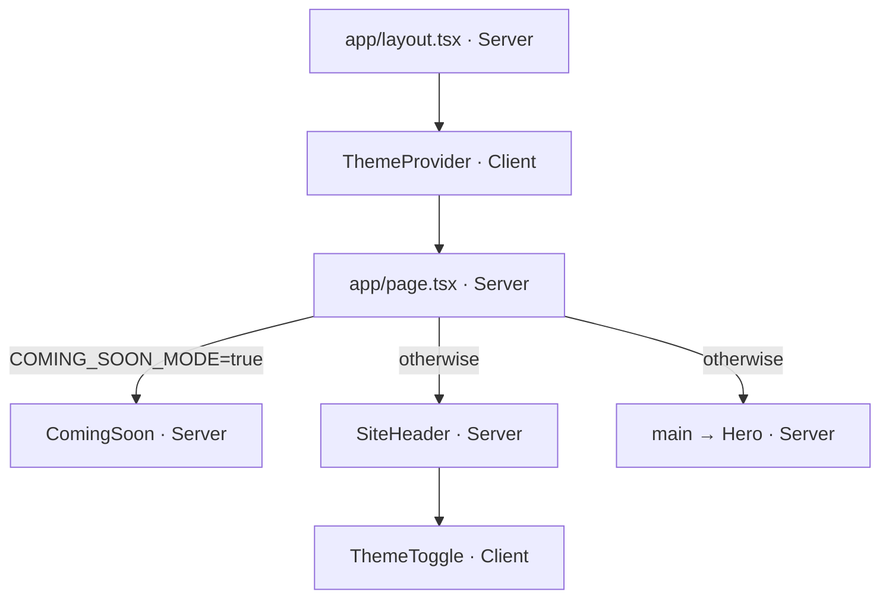

# Architecture

How the portfolio is built and where things go. Exact dependency versions live in [`package.json`](../package.json); this document doesn't repeat them.

## Stack

| Layer | Choice | Notes |
|---|---|---|
| Framework | Next.js, App Router | Turbopack for `dev` and `build`. Version-matched docs ship in `node_modules/next/dist/docs/`. |
| UI | React 19 | React Compiler enabled (`reactCompiler: true` in `next.config.ts`, via `babel-plugin-react-compiler`). |
| Language | TypeScript, `strict` | Path alias `@/*` → `src/*`. |
| Styling | Tailwind CSS v4 | CSS-first config in `src/app/globals.css` (no `tailwind.config.*`), PostCSS plugin `@tailwindcss/postcss`, animations from `tw-animate-css`, class merging with `cn()` (`clsx` + `tailwind-merge`). |
| Theming | `next-themes` | Wrapped by `src/components/theme/`. |
| Font | Jura via `next/font/google` | Exposed as `--font-jura`, mapped to `font-sans` and `font-mono`. |
| Lint | ESLint 9, flat config | `eslint-config-next` presets `core-web-vitals` and `typescript`. |
| Tooling | pnpm ≥ 10, Node.js ≥ 20.9.0 | `engine-strict=true` in `.npmrc`. |
| Hosting | Vercel | |

## Organization

The site is a single landing page, so the unit of organization is the **section**, not the feature.

- `page.tsx` only composes sections, in order. It holds no markup of its own beyond `<main>`.
- Each section is a Server Component that imports its data directly from `src/content/`.
- A section starts as one file. When it grows, it becomes a folder with everything it needs colocated, e.g. `sections/contact/` with `contact.tsx`, `contact-form.tsx`, `action.ts` and `schema.ts`.
- Real routes (project pages, a blog) are the trigger to move whatever became a domain into `src/features/`. Until then, don't anticipate that structure.

## Directory layout

```text
src/
├── app/
│   ├── layout.tsx              # <html lang="pt-BR">, font, metadata, ThemeProvider
│   ├── page.tsx                # COMING_SOON_MODE switch, then composes the sections in order
│   ├── globals.css             # Tailwind entry, design tokens, @theme mapping
│   └── favicon.ico
├── assets/icons/               # Static SVG logos, imported and rendered with next/image
├── components/
│   ├── sections/               # One file (or folder) per landing page section: hero.tsx
│   ├── ui/                     # Reusable primitives without content: container.tsx, icons.tsx
│   ├── theme/                  # theme-provider.tsx, theme-toggle.tsx, use-theme.ts
│   ├── coming-soon.tsx         # Full-page placeholder shown by the feature flag
│   └── site-header.tsx         # Page header (theme toggle; anchor navigation later)
├── content/                    # Typed data: site.ts (profile, social links), tech-stack.ts
└── lib/
    └── utils.ts                # cn()
public/                         # Files served from the site root (vercel.svg, currently unused)
docs/                           # Project standards
AGENTS.md                       # Instructions for AI coding agents
```

Planned, created only when there is real content or a real use for them:

| Path | Purpose |
|---|---|
| `components/sections/{about,projects,experience,contact}.tsx` | Remaining landing page sections |
| `components/ui/{button,badge,section-heading}.tsx` | Primitives the sections will share |
| `components/reveal.tsx` | Client component for scroll-triggered entrance animations |
| `components/site-footer.tsx` | Landing page footer |
| `content/{projects,experience}.ts` | Section data |
| `app/opengraph-image.tsx` | Generated share image |

## Rendering

- Every route is prerendered at build time (`○ (Static)` in the `pnpm build` output).
- Components are Server Components by default. The only client modules (`"use client"`) are the three files in `components/theme/`.
- There are no route handlers, Server Actions, `proxy.ts`, data fetching or database yet.



## Content

- `src/content/` holds plain typed data: no JSX, no styling, no fetching. Components decide how to present it.
- Export `as const` objects and arrays, plus derived types (`type SocialLink = (typeof socialLinks)[number]`).
- `site.ts` is the single source for the name, role, title, description and social links. `layout.tsx` builds the metadata from it, so the page and the metadata never diverge.
- Presentation details stay in components, not in content. For example, animation delays are computed from the item index.

## Anchor navigation

For when the header gets a menu:

- Add `scroll-smooth` to `<html>` and `scroll-mt-*` to each section, so the fixed header doesn't cover the headings.
- Centralize the section IDs in an `as const` object in `content/site.ts`, so the menu and the sections never diverge. IDs are in pt-BR, since they show up in the URL (`#projetos`).

## Environment variables

| Variable | Read in | Effect |
|---|---|---|
| `COMING_SOON_MODE` | `src/app/page.tsx` | `"true"` renders `ComingSoon`; any other value renders the landing page. |

- The home route is static, so the value is read **at build time**. Changing it requires a new build (`pnpm build`) or a Vercel redeploy; restarting `pnpm start` is not enough.
- Local values go in `.env.local` (gitignored, kept at the repository root). Every new variable must be added to `.env.example` and to the table above.
- Variables are server-only unless prefixed with `NEXT_PUBLIC_`, which inlines them into the browser bundle. Never put secrets in `NEXT_PUBLIC_` variables.

## Theming

- `ThemeProvider` (in `layout.tsx`) is configured with `attribute="class"`, `defaultTheme="system"`, `enableSystem` and `disableTransitionOnChange`.
- `next-themes` sets `class="dark"` or `class="light"` on `<html>`. The CSS treats dark as the default (`:root`) and overrides tokens under `html.light`. Token values: [design-system.md](design-system.md).
- `<html>` has `suppressHydrationWarning` because the theme class is set before React hydrates.
- Import `useTheme` and `ThemeMode` from `@/components/theme/use-theme`, not from `next-themes`: the wrapper narrows themes to `"light" | "dark" | "system"`.
- The theme is unknown during server rendering. Components that depend on it render a neutral state until mounted, as `ThemeToggle` does with `useSyncExternalStore`.

## Code conventions

- **File names:** kebab-case (`site-header.tsx`, `use-theme.ts`). Next.js special files keep their names (`page.tsx`, `layout.tsx`, `opengraph-image.tsx`).
- **Components:** PascalCase names and named exports (`export function SiteHeader()`). Default exports only for Next.js special files.
- **Imports:** use the `@/` alias (`@/components/ui/container`) across folders, and `./` relative imports only inside the same folder.
- **UI primitives** accept `className` and merge it with `cn()`, so callers can extend or override styles.
- **Types:** keep types next to the module that owns them (e.g. `ThemeMode` in `use-theme.ts`, `SocialLink` in `site.ts`).
- **React Compiler:** don't add `useMemo`, `useCallback` or `memo` for performance by default, and don't call `setState` synchronously inside effects (enforced by `react-hooks/set-state-in-effect`).
- **Images:** import local images statically and render them with `next/image`. SVGs are served as-is from `/_next/static/media`; keep `images.dangerouslyAllowSVG` disabled (the default).
- **Formatting:** no formatter is configured. Match the style of the file you are editing.

## Adding things

| To add | Do this |
|---|---|
| A landing page section | Create `src/components/sections/<name>.tsx` (Server Component), put its data in `src/content/<name>.ts` and add it to `page.tsx` in order. |
| A UI primitive | Create `src/components/ui/<name>.tsx`, accept `className`, follow [design-system.md](design-system.md). |
| Content | Add or extend a typed `as const` export in `src/content/`. |
| An icon or logo | Add the SVG to `src/assets/icons/` with a kebab-case name (`<name>-logo.svg`). |
| An environment variable | Add it to `.env.example` and to the table above; read it on the server. |
| A route | Only for real pages (project details, blog). Create `src/app/<route>/page.tsx` and revisit the [organization](#organization) rules. |
| A dependency | Run `pnpm add <pkg>` (`-D` for tooling) and follow the dependency policy below. |

## Quality gates

`pnpm lint`, `pnpm exec tsc --noEmit` and `pnpm build` must pass before every commit. There are no automated tests or CI yet.

## Dependency policy

- **pnpm only.** Commit `package.json` and `pnpm-lock.yaml` together, and never edit the lockfile by hand.
- **Exact pins** for `next`, `eslint-config-next`, `react`, `react-dom` and `babel-plugin-react-compiler`. Keep `next` and `eslint-config-next` on the same version, and `react` and `react-dom` on the same version. Everything else uses caret ranges.
- **Stable releases only** (`latest` dist-tag). Read the release notes and check `pnpm audit` before and after updating.
- **Check peer ranges before a major upgrade.** Current blockers:
  - TypeScript must stay below 6.1, the limit of `typescript-eslint`.
  - ESLint must stay on 9, the limit of `eslint-plugin-react`, `eslint-plugin-import` and `eslint-plugin-jsx-a11y`, which `eslint-config-next` bundles.
- **`@types/node`** follows the minimum supported Node.js major (currently 20), not the latest.
- **Install scripts:** pnpm blocks dependency build scripts. `pnpm-workspace.yaml` lists the ones intentionally ignored (`sharp`, `unrs-resolver`).
- After any update, run the quality gates and `pnpm audit`.
